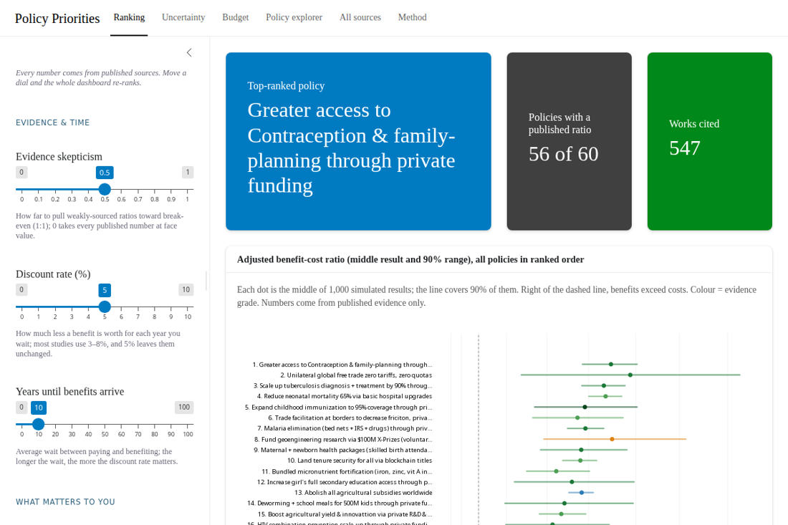

<br>
<br>

<h1>**Data Science**</h1>
<h6>***A collection of things I am learning & things I'm interested in.***</h6>
*[github.com/Tylerisyoung](https://www.github.com/tylerisyoung)
*

____________________________


```{r setup, include=FALSE}
knitr::opts_chunk$set(echo = TRUE)

library ("ggplot2")
library ("gridExtra")
library ("cowplot")
```

<br>
<br>


<center>
A benefit-cost ranking of 40 policies built on published estimates, extended into a multi-criteria decision analysis, all in R. Change the assumptions and watch the ranking move. <a href="./cba-dashboard/index.html" target="_blank">Open full screen</a>
</center>
<br>
<div id="cba-launch" style="width:96vw;max-width:1800px;position:relative;left:50%;transform:translateX(-50%);margin:0;border:1px solid #ddd;border-radius:8px;overflow:hidden;cursor:pointer" onclick="(function(el){el.outerHTML='<iframe src=\'./cba-dashboard/index.html\' height=\'1400\' style=\'width:96vw;max-width:1800px;position:relative;left:50%;transform:translateX(-50%);border:1px solid #ddd;border-radius:6px\' title=\'Policy Priorities dashboard\'></iframe>';})(this)">

<div style="position:absolute;inset:0;display:flex;flex-direction:column;align-items:center;justify-content:center;text-align:center;color:#fff;padding:20px">
<div style="font-size:1.6em;font-weight:bold;text-shadow:0 2px 8px rgba(0,0,0,.6)">Launch the dashboard</div>
<div style="margin-top:12px;padding:12px 28px;border-radius:99px;background:linear-gradient(90deg,#e07a7a,#f2c46d,#5b8def);font-weight:bold;box-shadow:0 4px 14px rgba(0,0,0,.3)">&#9654; Click to load</div>
<div style="margin-top:12px;max-width:520px;font-size:.9em;text-shadow:0 1px 4px rgba(0,0,0,.7)">It runs the R language inside your browser, so the first load downloads about 43&nbsp;MB and can take from 30 seconds to a few minutes. A progress bar shows the time left.</div>
</div></div>

<!-- POLICY VERDICTS TABLE (start) -->
<style>#policy-verdicts td,#policy-verdicts th{padding:10px 8px;vertical-align:top;border-top:1px solid #e5e7eb;line-height:1.45}#policy-verdicts thead th{border-top:none;border-bottom:2px solid #cfd6e0}</style>
<div id="policy-verdicts" style="max-width:1100px;margin:40px auto 0">
<h3 style="text-align:center">The 40 Policies: Good Decision or Bad Decision</h3>
<p style="text-align:center;color:#556">In the dashboard&#39;s final ranking order. The dashboard does the math; this is the why, three sentences each.</p>
<div style="overflow-x:auto">
<table class="table table-condensed" style="width:100%;font-size:.95em">
<thead><tr><th style="text-align:center;width:4em">Rank</th><th style="width:24%">Policy</th><th style="text-align:center;width:7em">Verdict</th><th>Why</th></tr></thead>
<tbody>
<tr><td style="text-align:center;font-weight:bold;color:#556">1</td><td style="font-weight:bold">Unilateral global free trade: zero tariffs, zero quotas</td><td style="text-align:center"><span style="display:inline-block;padding:2px 10px;border-radius:99px;background:#e3f3e9;color:#2f7a4e;font-weight:bold;font-size:.85em;white-space:nowrap">Good</span></td><td>Dropping every tariff and quota on your own, without waiting for anyone else, returns about $90 to $2,800 per dollar of adjustment cost. Countries that liberalise grow about 1.5 percentage points a year faster. The tariffs still in place in 2026 cost US households $760 to $940 a year each.</td></tr>
<tr><td style="text-align:center;font-weight:bold;color:#556">2</td><td style="font-weight:bold">Maternal &amp; newborn care: cut neonatal deaths 65% via basic hospital upgrades</td><td style="text-align:center"><span style="display:inline-block;padding:2px 10px;border-radius:99px;background:#e3f3e9;color:#2f7a4e;font-weight:bold;font-size:.85em;white-space:nowrap">Good</span></td><td>Trained staff, clean delivery, drugs to stop bleeding, antibiotics and newborn resuscitation could prevent most newborn deaths in poor countries. Basic hospital upgrades return $62 to $80 per dollar on a full cost of about $4.7 billion a year. Few things on this list save lives so cheaply, and private funders could carry much of the bill.</td></tr>
<tr><td style="text-align:center;font-weight:bold;color:#556">3</td><td style="font-weight:bold">Contraception &amp; family planning</td><td style="text-align:center"><span style="display:inline-block;padding:2px 10px;border-radius:99px;background:#e3f3e9;color:#2f7a4e;font-weight:bold;font-size:.85em;white-space:nowrap">Good</span></td><td>About 214 million women in poor countries want to avoid pregnancy and lack modern contraception, and reaching them costs about $3.6 billion a year. The return is about $20 to $112 per dollar, with health benefits alone worth about $40. A 15-year trial in Ghana adds that paying for girls to finish secondary school delayed childbearing, raised their earnings and halved infant deaths among their children.</td></tr>
<tr><td style="text-align:center;font-weight:bold;color:#556">4</td><td style="font-weight:bold">Scale up tuberculosis diagnosis + treatment by 90%</td><td style="text-align:center"><span style="display:inline-block;padding:2px 10px;border-radius:99px;background:#e3f3e9;color:#2f7a4e;font-weight:bold;font-size:.85em;white-space:nowrap">Good</span></td><td>Tuberculosis is curable, yet it still kills on a huge scale in poor countries. Rapid tests, screening and full treatment courses would save close to a million lives a year at roughly $2,000 per death averted. The return is $26 to $79 per dollar on about $6.7 billion a year, one of the best places on the list for a philanthropist&#x27;s money.</td></tr>
<tr><td style="text-align:center;font-weight:bold;color:#556">5</td><td style="font-weight:bold">Privately funded innovation prizes (X-Prize style)</td><td style="text-align:center"><span style="display:inline-block;padding:2px 10px;border-radius:99px;background:#e3f3e9;color:#2f7a4e;font-weight:bold;font-size:.85em;white-space:nowrap">Good</span></td><td>Prizes and advance market commitments pay only when someone delivers a defined result, so donors buy outcomes rather than promises. The research they would fund has some of the best returns anywhere, about $8.90 to $348 per dollar when clean energy, farm and geoengineering research are weighted equally. It costs taxpayers nothing, which is the best price of all.</td></tr>
<tr><td style="text-align:center;font-weight:bold;color:#556">6</td><td style="font-weight:bold">Childhood immunization</td><td style="text-align:center"><span style="display:inline-block;padding:2px 10px;border-radius:99px;background:#e3f3e9;color:#2f7a4e;font-weight:bold;font-size:.85em;white-space:nowrap">Good</span></td><td>Routine childhood vaccines in poor countries return about $14 to $94 per dollar on full cost, one of the best-documented bargains in health. The core package costs about $1.5 billion a year in programme spending and saves about 523,000 lives a year. The hard part is reaching the last 10 to 15% of children, and private donors are well placed to pay for it.</td></tr>
<tr><td style="text-align:center;font-weight:bold;color:#556">7</td><td style="font-weight:bold">Malaria: bed nets, seasonal chemoprevention, treatment</td><td style="text-align:center"><span style="display:inline-block;padding:2px 10px;border-radius:99px;background:#e3f3e9;color:#2f7a4e;font-weight:bold;font-size:.85em;white-space:nowrap">Good</span></td><td>Malaria still kills about 610,000 people a year, mostly African children, and bed nets, seasonal preventive drugs and cheap treatment return $17 to $45 per dollar on full cost. GiveWell puts the price of a life saved at $4,000 to $5,500. The global funding gap is about $5.4 billion a year, an easy target for private philanthropy.</td></tr>
<tr><td style="text-align:center;font-weight:bold;color:#556">8</td><td style="font-weight:bold">School-based deworming</td><td style="text-align:center"><span style="display:inline-block;padding:2px 10px;border-radius:99px;background:#e3f3e9;color:#2f7a4e;font-weight:bold;font-size:.85em;white-space:nowrap">Good</span></td><td>A pill once or twice a year clears worms that sap children&#x27;s nutrition and school attendance, at about 30 cents a child. A 20-year randomized follow-up in Kenya found treated children earned and consumed more as adults, a 37% annual social return. The wider evidence is disputed, so the range runs from $6 to $100 per dollar, but the whole programme costs under $0.3 billion a year.</td></tr>
<tr><td style="text-align:center;font-weight:bold;color:#556">9</td><td style="font-weight:bold">Tobacco and alcohol excise taxes</td><td style="text-align:center"><span style="display:inline-block;padding:2px 10px;border-radius:99px;background:#e3f3e9;color:#2f7a4e;font-weight:bold;font-size:.85em;white-space:nowrap">Good</span></td><td>Higher prices cut smoking and heavy drinking, especially among the young and poor, and doubling real cigarette prices could cut smoking by about a third. Estimates run from about $3 to $100 per dollar of social cost, after counting tax collection, smuggling enforcement and a 10% loss to illicit cigarettes. Of all the taxes a government can levy, one on a product that kills its users is among the easiest to defend.</td></tr>
<tr><td style="text-align:center;font-weight:bold;color:#556">10</td><td style="font-weight:bold">HIV prevention (voluntary medical male circumcision)</td><td style="text-align:center"><span style="display:inline-block;padding:2px 10px;border-radius:99px;background:#e3f3e9;color:#2f7a4e;font-weight:bold;font-size:.85em;white-space:nowrap">Good</span></td><td>Three randomized trials found voluntary medical circumcision cuts men&#x27;s risk of acquiring HIV by about 60%, for a one-off procedure costing under $100. The programme in the hardest-hit Southern African countries costs only $30 to $35 million a year and saves more in future HIV treatment than it costs. Returns of $6.80 to $53 per dollar are falling where HIV is declining, which is a nice problem to have.</td></tr>
<tr><td style="text-align:center;font-weight:bold;color:#556">11</td><td style="font-weight:bold">Repeal the Jones Act</td><td style="text-align:center"><span style="display:inline-block;padding:2px 10px;border-radius:99px;background:#e3f3e9;color:#2f7a4e;font-weight:bold;font-size:.85em;white-space:nowrap">Good</span></td><td>Since 1920, goods moving between US ports have had to travel on US-built, US-owned, US-crewed ships that cost several times more to build and run. Official modelling finds repeal would raise US welfare by $0.7 to $9.8 billion a year, and Puerto Rico households alone pay about $692 million a year for the law. Against one-time losses for about 10,800 displaced workers, repeal returns about $4 to $112 per dollar.</td></tr>
<tr><td style="text-align:center;font-weight:bold;color:#556">12</td><td style="font-weight:bold">Micronutrients</td><td style="text-align:center"><span style="display:inline-block;padding:2px 10px;border-radius:99px;background:#e3f3e9;color:#2f7a4e;font-weight:bold;font-size:.85em;white-space:nowrap">Good</span></td><td>Iron, zinc and vitamin A in flour, salt and oil, plus prenatal tablets and vitamin A capsules for young children, cost cents to a few dollars per person a year. Vitamin A capsules cut child deaths by about 12% in trials, and iodized salt alone returns about $30 per dollar. The whole package costs about half a billion dollars a year for $5.60 to $35 back per dollar.</td></tr>
<tr><td style="text-align:center;font-weight:bold;color:#556">13</td><td style="font-weight:bold">Blood-pressure and heart-disease drugs (aspirin, antihypertensives, polypill)</td><td style="text-align:center"><span style="display:inline-block;padding:2px 10px;border-radius:99px;background:#e3f3e9;color:#2f7a4e;font-weight:bold;font-size:.85em;white-space:nowrap">Good</span></td><td>Aspirin at the time of a heart attack returns about $63 per dollar and blood-pressure pills about $47, and both are cheap generics. Heart attacks and strokes are now the leading killers in many poor countries, and a primary-care scale-up costs roughly $2.4 billion a year. Even the narrowest estimates return about $3 per dollar, and the full range runs to $59.</td></tr>
<tr><td style="text-align:center;font-weight:bold;color:#556">14</td><td style="font-weight:bold">Abolish the Federal Reserve System</td><td style="text-align:center"><span style="display:inline-block;padding:2px 10px;border-radius:99px;background:#e3f3e9;color:#2f7a4e;font-weight:bold;font-size:.85em;white-space:nowrap">Good</span></td><td>The Fed era has brought far more inflation than before 1913 and no better growth, and banking crises since 1973 have come twice as often as under the classical gold standard. Replacing the Fed with gold-backed or competing private money returns about $1.60 to $47 per dollar of cost, centred near $6. The case weakens only under the highest gold-cost or smallest inflation-cost estimates, where the ratio dips below 1.</td></tr>
<tr><td style="text-align:center;font-weight:bold;color:#556">15</td><td style="font-weight:bold">Tradable fishing quotas (ITQs)</td><td style="text-align:center"><span style="display:inline-block;padding:2px 10px;border-radius:99px;background:#e3f3e9;color:#2f7a4e;font-weight:bold;font-size:.85em;white-space:nowrap">Good</span></td><td>Tradable quotas give fishers a secure, sellable share of the catch and end the race to empty the sea. Across more than 11,000 fisheries, those with catch shares were about half as likely to collapse. Each dollar of cost, including temporary catch cuts, returns about $2.80 to $16.</td></tr>
<tr><td style="text-align:center;font-weight:bold;color:#556">16</td><td style="font-weight:bold">Climate adaptation: early-warning systems and flood/nature defences</td><td style="text-align:center"><span style="display:inline-block;padding:2px 10px;border-radius:99px;background:#e3f3e9;color:#2f7a4e;font-weight:bold;font-size:.85em;white-space:nowrap">Good</span></td><td>Early-warning systems, flood defences, mangroves and marshes protect people from storms and floods, and official reviews consistently find about $2 to $10 back per dollar. Early warnings alone return $4 to $36 per dollar, and covering every developing country costs about $1 billion a year. Helping people cope with the weather they already get is the most practical climate spending there is.</td></tr>
<tr><td style="text-align:center;font-weight:bold;color:#556">17</td><td style="font-weight:bold">Privatize government land, parks and natural resources</td><td style="text-align:center"><span style="display:inline-block;padding:2px 10px;border-radius:99px;background:#e3f3e9;color:#2f7a4e;font-weight:bold;font-size:.85em;white-space:nowrap">Good</span></td><td>Four western states earn $14.51 per dollar of management cost on their trust lands, while the Forest Service and BLM earn 73 cents. Selling federal land and giving radio spectrum full, tradable property rights returns about $1.70 to $10 per dollar, and 60 MHz more mobile spectrum alone is worth about $8.8 billion a year to consumers. The open question is recreation and conservation value, which for the national parks alone is put at about $92 billion a year.</td></tr>
<tr><td style="text-align:center;font-weight:bold;color:#556">18</td><td style="font-weight:bold">Abolish the income tax</td><td style="text-align:center"><span style="display:inline-block;padding:2px 10px;border-radius:99px;background:#e3f3e9;color:#2f7a4e;font-weight:bold;font-size:.85em;white-space:nowrap">Good</span></td><td>Each dollar of income tax costs somewhere between 13 cents and $2 extra in lost work, saving and investment, and filing adds another $329 to $501 billion a year. Repeal means replacing about $3.1 trillion a year, mostly by shrinking government. The return is about $1.24 to $3.20 per dollar of revenue given up, and nobody will miss tax day.</td></tr>
<tr><td style="text-align:center;font-weight:bold;color:#556">19</td><td style="font-weight:bold">End Bailouts and Deposit Insurance</td><td style="text-align:center"><span style="display:inline-block;padding:2px 10px;border-radius:99px;background:#e3f3e9;color:#2f7a4e;font-weight:bold;font-size:.85em;white-space:nowrap">Good</span></td><td>Deposit insurance and bailouts let banks take risks with someone else&#x27;s money, and explicit insurance makes crises more likely where institutions are weak. Bank-run models still value the first dollars of cover highly, so the range is wide, at about 50 cents to $5.50 per dollar. Private replacement insurance would cost about $2.9 billion a year, and depositors would finally know who carries the risk.</td></tr>
<tr><td style="text-align:center;font-weight:bold;color:#556">20</td><td style="font-weight:bold">Abolish occupational licensing</td><td style="text-align:center"><span style="display:inline-block;padding:2px 10px;border-radius:99px;background:#e3f3e9;color:#2f7a4e;font-weight:bold;font-size:.85em;white-space:nowrap">Good</span></td><td>Licensing destroys about 12% of the economic surplus in the occupations it covers: consumers get 80 cents of quality per dollar of higher prices, and workers get back 60 cents per dollar of required training. It costs up to 2.85 million jobs and $203 billion a year in higher prices, and in trades like home improvement it raises prices with no gain in customer satisfaction. Abolition returns about $1.25 to $1.67 per dollar, less in high-risk jobs where some licences do save lives.</td></tr>
<tr><td style="text-align:center;font-weight:bold;color:#556">21</td><td style="font-weight:bold">Privatize Social Security into personal accounts</td><td style="text-align:center"><span style="display:inline-block;padding:2px 10px;border-radius:99px;background:#e3f3e9;color:#2f7a4e;font-weight:bold;font-size:.85em;white-space:nowrap">Good</span></td><td>Funded personal accounts let workers own their retirement savings, and about 2% of payroll eventually replaces the 12.4% payroll tax. Capital and wages rise, though today&#x27;s workers must also keep paying for the benefits already promised. Counting both sides, each dollar of transition cost returns about $1 to $2.</td></tr>
<tr><td style="text-align:center;font-weight:bold;color:#556">22</td><td style="font-weight:bold">Medicare drug-price negotiation</td><td style="text-align:center"><span style="display:inline-block;padding:2px 10px;border-radius:99px;background:#e3f3e9;color:#2f7a4e;font-weight:bold;font-size:.85em;white-space:nowrap">Good</span></td><td>Medicare is a buyer, and haggling over price is what buyers do; enrollees save about $2.2 billion a year out of pocket on the first 25 drugs. Patients who pay less for medicines take more of them, which on these savings means about 3,583 deaths averted a year. The cost is a small loss of new drugs, about 13 of 1,300 over 30 years, so each dollar returns between 57 cents and $2.80.</td></tr>
<tr><td style="text-align:center;font-weight:bold;color:#556">23</td><td style="font-weight:bold">Repeal minimum-wage laws</td><td style="text-align:center"><span style="display:inline-block;padding:2px 10px;border-radius:99px;background:#fbe6e6;color:#a33b3b;font-weight:bold;font-size:.85em;white-space:nowrap">Bad</span></td><td>Repeal would leave pay to agreement between employer and worker. The evidence is genuinely split, with some studies finding job losses for low-skill workers and the leading bunching study finding none. The ratio runs from about 70 cents to $1.40 and lands just under 1, a near wash because most of the effect is a transfer, so it misses the bar by a hair.</td></tr>
<tr><td style="text-align:center;font-weight:bold;color:#556">24</td><td style="font-weight:bold">Ocean and waterway protection</td><td style="text-align:center"><span style="display:inline-block;padding:2px 10px;border-radius:99px;background:#fbe6e6;color:#a33b3b;font-weight:bold;font-size:.85em;white-space:nowrap">Bad</span></td><td>Marine protected areas look good on paper, with the most complete global model finding $1.40 to $2.70 back per dollar. That model assumes they work, and a Nature study of 87 of them found only 9 had the features that make protection effective. Counting benefits only where protection works gives about 12 cents per dollar, and fishers carry most of the cost through lost access.</td></tr>
<tr><td style="text-align:center;font-weight:bold;color:#556">25</td><td style="font-weight:bold">Conserve forests and land / end deforestation</td><td style="text-align:center"><span style="display:inline-block;padding:2px 10px;border-radius:99px;background:#fbe6e6;color:#a33b3b;font-weight:bold;font-size:.85em;white-space:nowrap">Bad</span></td><td>Paying people to keep tropical forests standing sounds cheap, and a randomized trial in Uganda did find $2.40 of climate benefit per dollar while the payments lasted. Most of the money ends up buying carbon credits, though, and only about 6% of those reflected real reductions, while 42 to 95% of protection in one place is offset by clearing somewhere else. That leaves about 9 cents back per dollar on a bill of roughly $33 billion a year.</td></tr>
<tr><td style="text-align:center;font-weight:bold;color:#556">26</td><td style="font-weight:bold">Global carbon tax $135/tCO2 by 2030 (Paris)</td><td style="text-align:center"><span style="display:inline-block;padding:2px 10px;border-radius:99px;background:#fbe6e6;color:#a33b3b;font-weight:bold;font-size:.85em;white-space:nowrap">Bad</span></td><td>A $135-per-tonne global tax is about twice the price the leading climate-economy model calls optimal, and published studies put its cost at 5.6% of world output, roughly $5.9 trillion a year. Its climate benefits come to 2.2 to 3.1% of world output, so each dollar returns about 16 to 55 cents. A world economy 5 to 11% smaller also means an estimated 152,000 to 505,000 more infant deaths a year in poor countries.</td></tr>
<tr><td style="text-align:center;font-weight:bold;color:#556">27</td><td style="font-weight:bold">Rent control / rent caps</td><td style="text-align:center"><span style="display:inline-block;padding:2px 10px;border-radius:99px;background:#fbe6e6;color:#a33b3b;font-weight:bold;font-size:.85em;white-space:nowrap">Bad</span></td><td>Over 85% of voters in one large survey support capping rents, while 80 to 89% of the economists on a leading expert panel say caps don&#x27;t help. In San Francisco and Saint Paul, covered tenants gained but landlords pulled 15% of units off the rental market, which raised rents for everyone else. Add rent boards, apartments held by the wrong households and faster decay, and each dollar moved returns only 5 to 62 cents.</td></tr>
<tr><td style="text-align:center;font-weight:bold;color:#556">28</td><td style="font-weight:bold">Renewable-energy subsidies, tax credits and mandates</td><td style="text-align:center"><span style="display:inline-block;padding:2px 10px;border-radius:99px;background:#fbe6e6;color:#a33b3b;font-weight:bold;font-size:.85em;white-space:nowrap">Bad</span></td><td>Wind and solar subsidies do cut emissions, but at wildly different prices, up to about $2,100 per tonne of CO2 for solar in Germany and Spain. Counting the federal credits and the higher power bills from state mandates, the cost is around $238 billion a year for 2 to 75 cents back per dollar. Where wind and solar are already cheapest they need no help, and where they aren&#x27;t, the subsidy buys very expensive tonnes.</td></tr>
<tr><td style="text-align:center;font-weight:bold;color:#556">29</td><td style="font-weight:bold">Ban sales of new combustion-engine cars and trucks</td><td style="text-align:center"><span style="display:inline-block;padding:2px 10px;border-radius:99px;background:#fbe6e6;color:#a33b3b;font-weight:bold;font-size:.85em;white-space:nowrap">Bad</span></td><td>On coal-heavy grids like most of Asia&#x27;s, an electric car can do more pollution damage than the gasoline car it replaces, and an analysis of the UK&#x27;s 2030 ban puts costs at five times the benefits. Battery trucks cost more than twice as much as diesel and carry about 13,800 lb less, and batteries, grid upgrades and chargers for cars run about $535 to $985 billion a year. If electric vehicles are better, people will buy them without being ordered to.</td></tr>
<tr><td style="text-align:center;font-weight:bold;color:#556">30</td><td style="font-weight:bold">Digital ID mandate worldwide</td><td style="text-align:center"><span style="display:inline-block;padding:2px 10px;border-radius:99px;background:#fbe6e6;color:#a33b3b;font-weight:bold;font-size:.85em;white-space:nowrap">Bad</span></td><td>Only 42% of Britons back the UK plan, and the best evidence comes from two randomized trials in India. When biometric checks became compulsory for food rations, corruption did not fall, costs rose about 8% and hundreds of thousands of legitimate recipients lost benefits, about minus $1 per dollar. A carefully managed biometric payment system in Andhra Pradesh roughly paid for itself at about $1.10 per dollar, and that is before counting privacy and surveillance risks.</td></tr>
<tr><td style="text-align:center;font-weight:bold;color:#556">31</td><td style="font-weight:bold">Global plastic ban + single-use mandates</td><td style="text-align:center"><span style="display:inline-block;padding:2px 10px;border-radius:99px;background:#fbe6e6;color:#a33b3b;font-weight:bold;font-size:.85em;white-space:nowrap">Bad</span></td><td>Canada&#x27;s single-use plastics ban returns about 31 cents per dollar and England&#x27;s straw ban as little as 3 cents. The paper, glass, metal and cotton substitutes usually weigh more and emit more greenhouse gas, adding an estimated $394 billion a year in environmental damage. Add a GDP cost of about $870 billion a year and a global ban returns somewhere between minus 42 and plus 30 cents per dollar.</td></tr>
<tr><td style="text-align:center;font-weight:bold;color:#556">32</td><td style="font-weight:bold">Block Social Security/Medicare age or benefit changes</td><td style="text-align:center"><span style="display:inline-block;padding:2px 10px;border-radius:99px;background:#fbe6e6;color:#a33b3b;font-weight:bold;font-size:.85em;white-space:nowrap">Bad</span></td><td>Shielding Social Security and Medicare from any change polls at net +72, but the Trustees put the gap at about $535 billion a year on average over 75 years. Blocking higher retirement ages means that gap gets filled with taxes or borrowing, and it forgoes the extra work and tax revenue of longer careers. Each dollar returns between minus $1.27 and plus 66 cents, and younger workers get the bill.</td></tr>
<tr><td style="text-align:center;font-weight:bold;color:#556">33</td><td style="font-weight:bold">Broad student-loan forgiveness</td><td style="text-align:center"><span style="display:inline-block;padding:2px 10px;border-radius:99px;background:#fbe6e6;color:#a33b3b;font-weight:bold;font-size:.85em;white-space:nowrap">Bad</span></td><td>The 2022 forgiveness plan would have cost about $400 billion, roughly $40 billion a year over a decade, and the benefits tilt toward higher earners. Expected future forgiveness encourages more borrowing, which one model says adds 39 to 63% to the cost, and much of the extra student lending ends up as higher tuition. Each dollar is worth a dollar to borrowers but costs taxpayers more, so the return runs from about minus $1.39 to plus 67 cents.</td></tr>
<tr><td style="text-align:center;font-weight:bold;color:#556">34</td><td style="font-weight:bold">Domestic manufacturing mandates</td><td style="text-align:center"><span style="display:inline-block;padding:2px 10px;border-radius:99px;background:#fbe6e6;color:#a33b3b;font-weight:bold;font-size:.85em;white-space:nowrap">Bad</span></td><td>Buy American rules make governments pay more so that some US factories stay busy, at about $94 billion a year across US governments. That works out to $111,500 to $262,000 per job preserved, before up to $188 billion of drag from the taxes that pay for it. Each dollar spent returns between minus $1.59 and plus 24 cents.</td></tr>
<tr><td style="text-align:center;font-weight:bold;color:#556">35</td><td style="font-weight:bold">Medicare for All (single payer)</td><td style="text-align:center"><span style="display:inline-block;padding:2px 10px;border-radius:99px;background:#fbe6e6;color:#a33b3b;font-weight:bold;font-size:.85em;white-space:nowrap">Bad</span></td><td>Medicare for All has 66% support and would add $1.5 to $3.0 trillion a year in federal spending. Taxes on that scale could shrink GDP by as much as 9%, and Canadian-length waits of 30 weeks would cost patients about $67 billion a year in lost time. Even counting lives saved, each dollar destroys 57 to 77 cents of value.</td></tr>
<tr><td style="text-align:center;font-weight:bold;color:#556">36</td><td style="font-weight:bold">Price Controls &amp; Price Gouging</td><td style="text-align:center"><span style="display:inline-block;padding:2px 10px;border-radius:99px;background:#fbe6e6;color:#a33b3b;font-weight:bold;font-size:.85em;white-space:nowrap">Bad</span></td><td>Price caps poll well, with 65% of likely voters backing a crackdown on grocery price gouging, but 88% of surveyed economists agree widespread controls create substantial distortions. High prices in an emergency are the signal that pulls supplies toward the people who need them most. Under the 1970s gasoline controls, queues alone burned about 116% of the money moved from sellers to buyers, and each dollar shifted destroys 44 cents to $1.29 of value.</td></tr>
<tr><td style="text-align:center;font-weight:bold;color:#556">37</td><td style="font-weight:bold">Globally Strict Border Controls</td><td style="text-align:center"><span style="display:inline-block;padding:2px 10px;border-radius:99px;background:#fbe6e6;color:#a33b3b;font-weight:bold;font-size:.85em;white-space:nowrap">Bad</span></td><td>This applies the 2025-26 US enforcement build-up to every major destination country, at up to about $533,000 per person deterred. The people kept out lose earnings several times what they could make at home, and high-skill natives lose too, which far outweighs the gains to some native workers and the budget. Each dollar of enforcement destroys about 97 cents to $1.31 of value.</td></tr>
<tr><td style="text-align:center;font-weight:bold;color:#556">38</td><td style="font-weight:bold">Universal basic income (global)</td><td style="text-align:center"><span style="display:inline-block;padding:2px 10px;border-radius:99px;background:#fbe6e6;color:#a33b3b;font-weight:bold;font-size:.85em;white-space:nowrap">Bad</span></td><td>A randomized US trial found every dollar paid out cut household earnings by 28 to 37 cents, with partners cutting work as much as recipients. A global version would cost roughly a third of world GDP, far more than taxes can raise without heavy losses, and one model finds it would shrink GDP by about 13%. Each dollar returns between minus $1.26 and minus $1.09, while donor-funded cash in poor Kenyan villages shows the same idea working well as charity.</td></tr>
<tr><td style="text-align:center;font-weight:bold;color:#556">39</td><td style="font-weight:bold">Green New Deal (all Western nations)</td><td style="text-align:center"><span style="display:inline-block;padding:2px 10px;border-radius:99px;background:#fbe6e6;color:#a33b3b;font-weight:bold;font-size:.85em;white-space:nowrap">Bad</span></td><td>Here every Western nation adopts the Green New Deal, and its outlays alone come to about a third of Western GDP, more than four times the most extra revenue US taxes could ever raise. Because only the West cuts, 12% to 130% of the reduction leaks abroad, and at the top of that range world emissions actually rise. Each dollar destroys about $1.19 to $1.34 of value, and the slower growth costs an estimated 42,000 to 164,000 infant lives a year in poor countries.</td></tr>
<tr><td style="text-align:center;font-weight:bold;color:#556">40</td><td style="font-weight:bold">15-minute cities (C40 consumption scenario)</td><td style="text-align:center"><span style="display:inline-block;padding:2px 10px;border-radius:99px;background:#fbe6e6;color:#a33b3b;font-weight:bold;font-size:.85em;white-space:nowrap">Bad</span></td><td>Daily needs within a short walk is a fine planning idea, but this version turns C40&#x27;s &#x27;ambitious&#x27; consumption targets into mandates: no meat or dairy, three new clothing items a year, no private cars and one short-haul return flight every three years. The cost runs from about $1.9 to $8.0 trillion a year, including up to $1.9 trillion of lost productivity as 24-minute car commutes become 48 minutes by transit, against $0.3 to $0.8 trillion of benefits. Every dollar spent destroys between 92 cents and $12 of value, which makes this the worst policy on the list.</td></tr>
</tbody>
</table>
</div>
</div>
<!-- POLICY VERDICTS TABLE (end) -->


<br>
<br>

<br>
<br>
<br>
<br>
